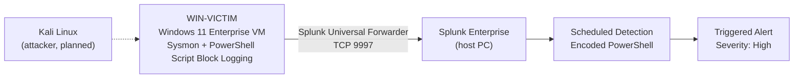
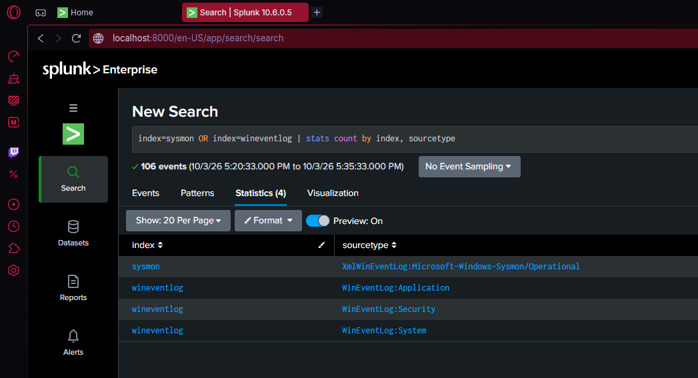
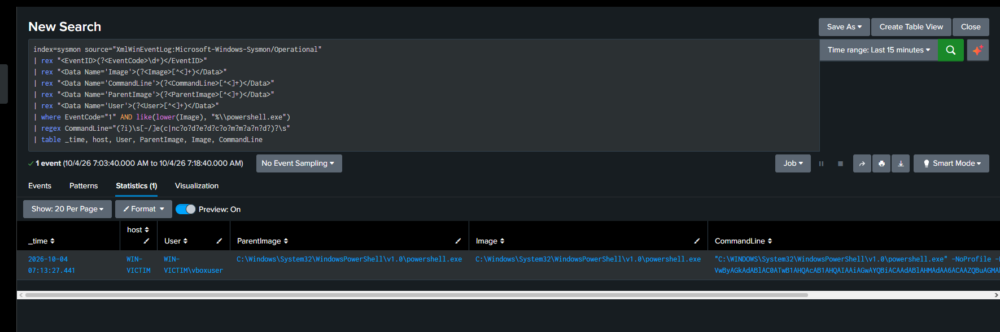
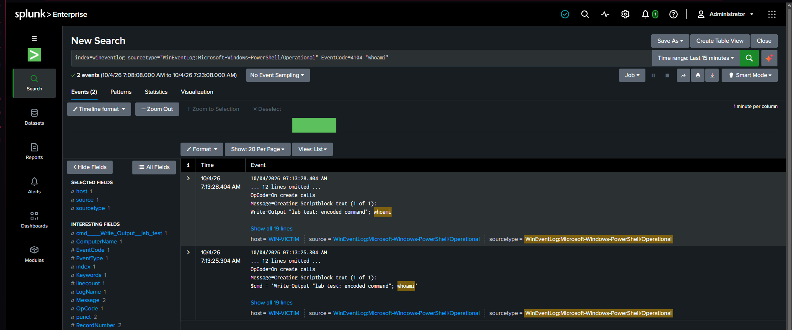
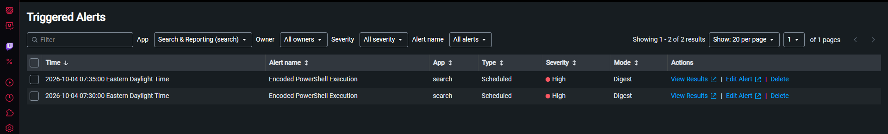

# Home SOC Lab: Sysmon + Splunk Detection Engineering

A home security operations lab built to practice the full detection loop: **simulate an attack → collect endpoint telemetry → detect it in a SIEM → investigate → alert.**

Built by **Sohan Koirala** (CompTIA Security+) as a hands-on SOC analyst portfolio project.

---

## Architecture



| Component | Details |
|---|---|
| Hypervisor | Oracle VirtualBox 7.x (NAT + host-only adapters) |
| Victim endpoint | Windows 11 Enterprise (evaluation), 4 GB RAM, 2–4 vCPU |
| Endpoint telemetry | Sysmon with the [SwiftOnSecurity configuration](https://github.com/SwiftOnSecurity/sysmon-config) |
| Additional logging | PowerShell Script Block Logging (Event ID 4104), Windows Security/System/Application logs |
| Log shipping | Splunk Universal Forwarder 10.0.2, running as Local System |
| SIEM | Splunk Enterprise 10.6 on the host PC |
| Add-ons | Splunk Add-on for Sysmon, Splunk Add-on for Microsoft Windows (SHA-256 verified before install) |

### Data sources and indexes

| Index | Source | What it gives the analyst |
|---|---|---|
| `sysmon` | Sysmon Operational | Process creation (EID 1), network connections (EID 3), file creation (EID 11), with full command lines and parent processes |
| `wineventlog` | Security | Logons, failed logons, account and privilege changes |
| `wineventlog` | PowerShell Operational | **Decoded** script contents (EID 4104), even when commands were obfuscated |
| `wineventlog` | System / Application | Service installs, crashes, context |

Forwarder configuration: [`configs/inputs.conf`](configs/inputs.conf)



---

## Detection 1: Encoded PowerShell Execution

**MITRE ATT&CK:** [T1059.001 – PowerShell](https://attack.mitre.org/techniques/T1059/001/) · [T1027.010 – Command Obfuscation](https://attack.mitre.org/techniques/T1027/010/)

### Why it matters
Attackers base64-encode PowerShell commands (`-EncodedCommand`) to hide their payload from analysts and simple keyword filters. Encoded commands are rare in normal administration, so they are a high-signal starting point for investigation.

### Attack simulation (run on WIN-VICTIM)
```powershell
$cmd = 'Write-Output "lab test: encoded command"; whoami'
$enc = [Convert]::ToBase64String([Text.Encoding]::Unicode.GetBytes($cmd))
powershell.exe -NoProfile -EncodedCommand $enc
```

### Detection logic
Full query: [`detections/encoded-powershell.spl`](detections/encoded-powershell.spl)

Key design decisions:
- **Matches every abbreviation of the flag.** PowerShell accepts `-e`, `-ec`, `-enc`, `-EncodedCommand` and anything in between, and attackers use short forms to evade naive searches. The regex `(?i)\s[-/]e(c|nc?o?d?e?d?c?o?m?m?a?n?d?)?\s` catches all of them, case-insensitive, with `-` or `/` prefixes.
- **Field extraction with `rex` directly from Sysmon's XML,** so the detection works even if add-on parsing fails (see Lessons Learned).
- **Triage-ready output:** time, host, user, parent process, and full command line.



### Investigation: pivoting to the decoded payload
The Sysmon event shows **that** an encoded command ran, but the payload is unreadable base64. PowerShell Script Block Logging records the script **after decoding**, so pivoting on host and timestamp reveals what actually executed:

```spl
index=wineventlog sourcetype="WinEventLog:Microsoft-Windows-PowerShell/Operational" EventCode=4104 "whoami"
```

The Sysmon process-creation event (07:13:27) and the 4104 script block (07:13:28) line up within one second on the same host, confirming the decoded payload: `Write-Output "lab test: encoded command"; whoami`.

Sysmon also captured the **child process** (`whoami.exe`) with the encoded PowerShell as its parent command line, which shows the process tree an analyst would follow to see what the attacker did next.



### Alerting
| Setting | Value | Reason |
|---|---|---|
| Schedule | Cron `*/5 * * * *` | Runs every 5 minutes |
| Time range | `-6m@m` to `-1m@m` | Minute-snapped windows with no gaps or overlap, plus a 1-minute buffer for forwarder delivery lag |
| Trigger | Number of results > 0 | One hit is worth a look |
| Throttle | 60 min by `host, CommandLine` | Prevents duplicate alerts for the same command on the same machine |
| Action | Add to Triggered Alerts, Severity High | |



---

## Lessons Learned (real issues hit during the build)

1. **Data arrived but fields didn't.** Sysmon events were indexed with `source = WinEventLog:...`, but the Sysmon add-on only parses `source = XmlWinEventLog:Microsoft-Windows-Sysmon/Operational`. Searches on `EventCode`, `Image`, and `CommandLine` silently returned 0 results. **Fix:** set `source` and `sourcetype` explicitly in `inputs.conf`, and write the detection with `rex` extraction so it doesn't depend on parsing. **Takeaway:** "0 results" doesn't mean "no attack"; always confirm the data and fields exist first.
2. **Duplicate alerts.** A single test attack fired the alert twice, because "last 5 minutes" windows measured from run time can overlap when the scheduler starts late, and forwarded events arrive about 30 seconds late. **Fix:** minute-snapped windows (`@m`), a 1-minute lag buffer, and throttling.
3. **Silent install failure.** The first forwarder install rolled back without an error because PowerShell wasn't elevated. **Fix:** reinstalled from the command line with `msiexec ... /l*v` logging, and confirmed the service with `Get-Service`.
4. **Service account matters.** The forwarder runs as Local System. A low-privilege account can't read the Security event log, which would produce Sysmon data with no Security logs and no error.
5. **Verify before you trust.** Every add-on and the forwarder installer were hash-verified (SHA-256/SHA-512) against vendor-published checksums before installation.

## Production Hardening Notes
This is a lab. In production I would also:
- Replace Splunk's default self-signed certificates (flagged in `splunkd.log` as MITM-prone) with CA-signed certificates and enable TLS on forwarder traffic.
- Restrict port 9997 with firewall rules to known forwarder IPs.
- Manage forwarders centrally with a deployment server instead of hand-edited configs.
- Tune the detection with an allowlist for known-good management tools that legitimately use encoded commands.

---

## Roadmap
- [x] Sysmon + Splunk pipeline
- [x] Detection 1: Encoded PowerShell (T1059.001, T1027.010)
- [ ] Detection 2: Brute-force logons (Event ID 4625 spikes)
- [ ] Detection 3: Suspicious parent-child processes (Office apps spawning shells)
- [ ] Network visibility with Zeek and Snort
- [ ] Attack simulation from Kali and Atomic Red Team, mapped to MITRE ATT&CK
- [ ] Full incident write-up of a multi-stage attack
